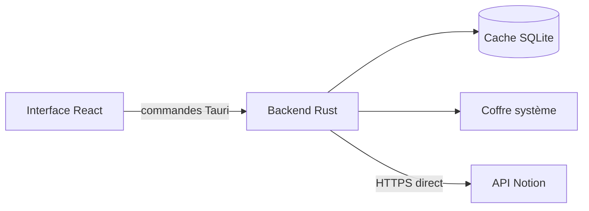

# Mes tâches — client de bureau local pour Notion

[](LICENSE)

**Mes tâches** est une application de bureau multiplateforme construite avec React, TypeScript, Tauri et Rust. Elle propose une saisie rapide inspirée des applications de tâches natives, tout en synchronisant les données avec une source de données Notion.

L’application fonctionne d’abord en local : les tâches restent accessibles sans connexion et les modifications sont placées dans une file d’attente SQLite jusqu’à la prochaine synchronisation.

## Fonctionnalités

- ajout immédiat d’une tâche avec la touche Entrée ;
- vues **Ma journée**, **À faire**, **Importantes**, **Plus tard** et **Terminées** ;
- modification du titre, de l’échéance, de la priorité, du statut, du responsable, de la source, de la description et du commentaire ;
- suppression avec confirmation et mise à la corbeille de la page correspondante dans Notion ;
- 8 couleurs, 8 dégradés et 15 illustrations fournies avec l’application ;
- thème mémorisé localement et indépendamment pour chaque vue ;
- cache SQLite et file de synchronisation persistante ;
- synchronisation directe avec l’API Notion, sans serveur intermédiaire ;
- jeton Notion conservé dans le coffre sécurisé du système.



## Préparer Notion

L’application attend une base contenant des propriétés dont les noms et les types sont précis.

| Propriété | Type Notion | Obligatoire |
| --- | --- | --- |
| `Tâche` | Titre | Oui |
| `Done` | Case à cocher | Oui |
| `Statut` | Sélection | Oui |
| `Priorité` | Sélection | Oui |
| `Echéance` | Date | Oui |
| `Fait le` | Date | Oui |
| `Resp.` | Sélection | Oui |
| `Source` | Sélection | Oui |
| `description` | Texte | Oui |
| `Commentaire` | Texte | Oui |
| `Type` | Sélection | Non |

La procédure complète explique la création de la base, les options recommandées, la connexion Notion et la récupération de l’identifiant : **[Configurer Notion](docs/notion-setup.md)**.

## Installer une version publiée

Les installateurs sont disponibles dans la section [Releases](https://github.com/RastaGrinch/mes-taches-notion/releases).

### macOS

1. Télécharger et décompresser `Mes-taches-macOS.zip`.
2. Déplacer **Mes tâches.app** dans le dossier **Applications**.
3. Comme l’application n’est pas encore signée avec un certificat Apple public, ouvrir le Terminal et exécuter :

```bash
xattr -dr com.apple.quarantine "/Applications/Mes tâches.app"
open "/Applications/Mes tâches.app"
```

Si macOS refuse la première commande pour un problème de droits, la relancer avec `sudo` :

```bash
sudo xattr -dr com.apple.quarantine "/Applications/Mes tâches.app"
```

Cette commande retire uniquement l’attribut de quarantaine ajouté au téléchargement de cette application.

### Windows

Télécharger `Mes-taches-Windows-x64-setup.exe`, lancer l’installateur, puis confirmer **Informations complémentaires → Exécuter quand même** si Microsoft Defender SmartScreen affiche un avertissement.

## Installation pour le développement

### Prérequis communs

- Node.js LTS et npm ;
- Rust stable ;
- les [prérequis Tauri 2](https://v2.tauri.app/start/prerequisites/) de la plateforme.

### Windows

Windows nécessite Microsoft Edge WebView2 et Visual Studio Build Tools 2022 avec la charge de travail **Développement Desktop en C++**.

```powershell
git clone https://github.com/RastaGrinch/mes-taches-notion.git
cd mes-taches-notion
npm ci
npm run tauri dev
```

### macOS

```bash
git clone https://github.com/RastaGrinch/mes-taches-notion.git
cd mes-taches-notion
npm ci
npm run tauri dev
```

## Connecter l’application à Notion

1. Créer une connexion interne ou un jeton d’accès personnel dans Notion.
2. Lui accorder les capacités **Read content**, **Update content** et **Insert content**.
3. Ajouter cette connexion à la page qui contient la base de tâches.
4. Copier l’identifiant de la source de données dans **Manage data sources**.
5. Ouvrir **Paramètres** dans l’application.
6. Coller l’identifiant et le jeton, puis choisir **Vérifier et connecter**.

L’application vérifie l’accès et le schéma avant d’enregistrer la connexion. Elle reste utilisable en mode local sans jeton.

## Vérifications et compilation

```bash
npm run build
cargo test --manifest-path src-tauri/Cargo.toml
cargo fmt --manifest-path src-tauri/Cargo.toml -- --check
```

Pour construire l’application sur le système courant :

```bash
npm run tauri build
```

Des scripts dédiés sont fournis :

```powershell
# Windows
.\scripts\build-windows.ps1
```

```bash
# macOS
./scripts/build-macos.sh
```

Une compilation croisée Windows depuis macOS est disponible avec `scripts/build-windows-from-macos.sh`. Tauri considère encore cette méthode comme expérimentale ; la validation finale doit être faite sur Windows.

## Données et sécurité

- Le jeton Notion n’est jamais stocké dans le dépôt, le frontend ou SQLite.
- Il est enregistré dans le Trousseau macOS, le Gestionnaire d’informations d’identification Windows ou le service de secrets natif de Linux.
- Le cache de tâches est enregistré dans le dossier de données local de l’application.
- Aucun middleware hébergé ni service analytique n’est utilisé.
- Le dépôt ne doit jamais contenir de fichier `.env`, de base SQLite ou de jeton Notion.

## Documentation

- [Configurer la base et la connexion Notion](docs/notion-setup.md)
- [Développer et compiler l’application](docs/development.md)
- [Architecture et synchronisation](docs/architecture.md)
- [Contribuer](CONTRIBUTING.md)
- [Politique de sécurité](SECURITY.md)

## État du projet

Le projet est en version `0.3.0`. Les installateurs macOS et Windows ne sont pas encore signés par un certificat de distribution public : Gatekeeper ou SmartScreen peuvent afficher un avertissement lors du premier lancement.

## Licence

Le code source et les ressources fournies avec l’application sont distribués sous la licence **GNU General Public License v3.0 uniquement** (`GPL-3.0-only`). Vous pouvez utiliser, étudier, modifier et redistribuer le projet. Toute version modifiée que vous distribuez doit rester sous cette même licence et être accompagnée de son code source.

Consultez le fichier [LICENSE](LICENSE) pour le texte complet de la licence.
